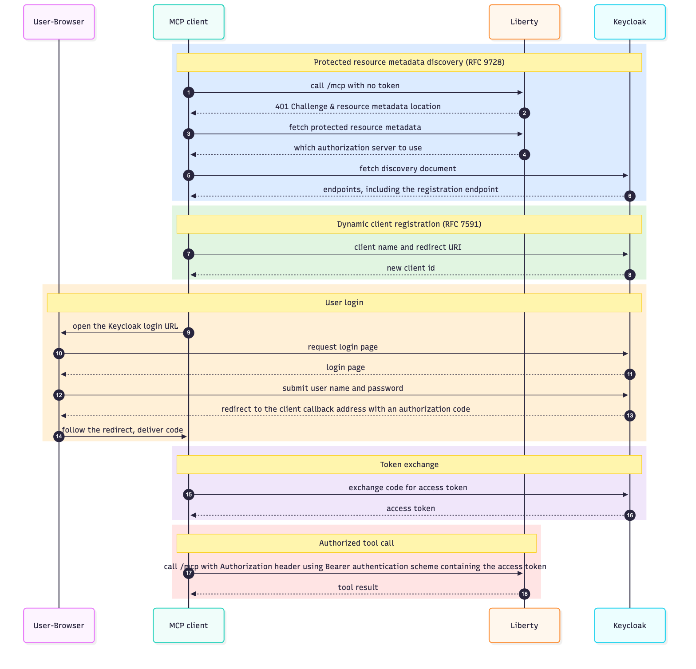

= Securing an Open Liberty MCP server with OAuth and Keycloak
Martin Drozdz <https://github.com/martindrozdz>
:imagesdir: /
:url-prefix:
:url-about: /

For HTTP-based MCP transports that support authorization, the https://modelcontextprotocol.io/docs/2025-11-25/getting-started/intro[MCP (Model Context Protocol) spec] spec requires OAuth. For this demo we picked https://www.keycloak.org/[Keycloak] as the authorization server because it's free and supports everything we need.

== Our demo

An AI assistant that can manage your tasks for you is useful. An AI assistant that lets someone impersonate you, or lets an ordinary user see and change other people's tasks, is a liability. In our demo, only you and an admin can update your tasks, only you and an admin can see them, and only an admin can delete them.

The moment an MCP server authorizes a person to perform an action, it should know:

- who that person is (via a user ID)
- what they are allowed to do (via a role)
- that the person is who they say they are (authentication)

The source code is at https://github.com/martindrozdz/liberty-mcp-oauth-keycloak[github.com/martindrozdz/liberty-mcp-oauth-keycloak]. To run the demo, you run `jbang Setup.java` from the project root. That script sets up the certificates and Keycloak for you. You then start Liberty with `./mvnw liberty:dev` in a new terminal (see <<Connecting and debugging>>). The Keycloak sections in this post explain what the script does, so that you understand the configuration.

This post explains what a task server does in a demo that we created and covers:

- the Open Liberty MCP server setup
- Java code demonstrating authorization decisions
- the Keycloak authorization server setup, which the `Setup.java` script performs
- how to get IBM Bob to trust the Open Liberty MCP server and Keycloak
- the purpose of OAuth in authorization

== Open Liberty

To enable an MCP server on Liberty, add the `jakartaee-10.0` platform and the `mcp-1.0` feature.
To enable security, add the `appSecurity` and `openidConnectClient-1.0` features in the https://github.com/martindrozdz/liberty-mcp-oauth-keycloak/blob/main/src/main/liberty/config/server.xml[`server.xml`] file:

.featureManager in server.xml
[source,xml]
----
<featureManager>
    <platform>jakartaee-10.0</platform>
    <feature>mcp-1.0</feature>
    <feature>appSecurity</feature>
    <feature>openidConnectClient-1.0</feature>
</featureManager>
----

[[liberty-config]]
=== Configuring Liberty to accept OAuth access tokens

Open Liberty is not configured to log users in or issue access tokens itself in this example. Keycloak does that.

The `openidConnectClient` element in the https://github.com/martindrozdz/liberty-mcp-oauth-keycloak/blob/main/src/main/liberty/config/server.xml[`server.xml`] file configures the OpenID Connect client behavior in Liberty:

.openidConnectClient and authFilter in server.xml
[source,xml]
----
<openidConnectClient
    id="mcp-oidc-config"
    clientId="liberty-mcp-server"
    clientSecret="${OAUTH_CLIENT_SECRET}"
    discoveryEndpointUrl="https://localhost:8443/realms/liberty-demo/.well-known/openid-configuration"
    authFilterRef="mcp-auth-filter"
    signatureAlgorithm="RS256"
    audiences="liberty-mcp-server"
    inboundPropagation="required"
    tokenReuse="true">
    <protectedResourceMetadata advertisedScopes="mcp-demo-server,profile"/>
</openidConnectClient>

<authFilter id="mcp-auth-filter">
    <requestUrl urlPattern="/mcp" matchType="contains" />
</authFilter>
----

The OpenID Connect configuration helps Liberty to know:

- where to find Keycloak

`protectedResourceMetadata`: Publishes metadata that tells MCP clients which authorization server and scopes to use. This is what makes the <<detailed-flow,five-phase discovery sequence>> possible. It also shows which servers Liberty trusts to act as authorization servers for the AI assistants.

`discoveryEndpointUrl`: Liberty reads Keycloak's discovery document at startup and learns the token endpoint and signing keys.

- which access tokens to accept

`audiences`: Rejects any token whose `aud` claim does not include `liberty-mcp-server`. This stops a token issued for another service from working here.

- which scopes are important to get roles for a user (in this case the roles are stored in the `groupIds` claim)

`advertisedScopes`: show that the `mcp-demo-server` and `profile` scopes are needed to find role information.

Other important configuration elements:

`clientId` and `clientSecret`::
Liberty's own identity in Keycloak. The secret comes from the `src/main/liberty/config/server.env` file so it is not committed in the XML. `SetupLocalKeycloak.java` generates that file, and it is gitignored. The file contains a single line: `OAUTH_CLIENT_SECRET=<value>`.
+
[WARNING]
====
Never commit `server.env`. It is gitignored in this project because it contains the client secret.
====

`inboundPropagation="required"`::
Liberty accepts only tokens that the client already holds. It never starts a browser login itself.

The `authFilter` element expects access tokens to be present for URLs that match a specified pattern.
The specified pattern in this case is `/mcp`, and it must be present in the URL.

[[web-xml-roles]]
=== Configuring who can access the MCP server

There are two layers of authorization here:

- The <openidConnectClient> in https://github.com/martindrozdz/liberty-mcp-oauth-keycloak/blob/main/src/main/liberty/config/server.xml[`server.xml`] tells liberty how to read and validate an access token
- The https://github.com/martindrozdz/liberty-mcp-oauth-keycloak/blob/main/src/main/webapp/WEB-INF/web.xml[`web.xml`] tells liberty what roles the user must have to access resources with the specified url-pattern

.security-constraint in web.xml
[source,xml]
----
<security-constraint>
    <web-resource-collection>
        <web-resource-name>All resources</web-resource-name>
        <url-pattern>/*</url-pattern>
    </web-resource-collection>
    <auth-constraint>
        <role-name>taskadmin</role-name> <!--1-->
        <role-name>taskuser</role-name> <!--1-->
    </auth-constraint>
</security-constraint>

<security-role>
    <role-name>taskadmin</role-name> <!--2-->
</security-role>
<security-role>
    <role-name>taskuser</role-name> <!--2-->
</security-role>
----
<1> These role names tell the MCP server which roles a user needs to have in the access token.
<2> These elements declare the roles that the application uses.

If the user has neither the `taskadmin` nor the `taskuser` role in the access token, the user is denied access to the MCP server.

== Java code

The tools are in https://github.com/martindrozdz/liberty-mcp-oauth-keycloak/blob/main/src/main/java/com/example/tasks/TaskTools.java[`TaskTools.java`]. It uses https://github.com/martindrozdz/liberty-mcp-oauth-keycloak/blob/main/src/main/java/com/example/tasks/TaskService.java[`TaskService.java`] and https://github.com/martindrozdz/liberty-mcp-oauth-keycloak/blob/main/src/main/java/com/example/tasks/Task.java[`Task.java`] to store the tasks. The snippets below are shortened.

=== Authorization Pattern 1: Identity preservation

This pattern records the task owner so that only authorized users can access it. Liberty reads the `sub` claim from the validated token (see callout 1) via `getUserPrincipal().getName()`, and the tool stores it as the immutable owner of the new task. For user-facing feedback, `getDisplayName()` extracts the `preferred_username` claim directly from the validated Bearer token payload.

.createTask: identity preservation
[source,java]
----
@ApplicationScoped
public class TaskTools {

    @Inject
    TaskService taskService;

    @Inject
    HttpServletRequest httpRequest;

    @Tool(description = "Create a task")
    public String createTask(
            @ToolArg(name = "title", description = "Task title") String title,
            @ToolArg(name = "description", description = "Task description") String description) {

        String userId = httpRequest.getUserPrincipal().getName(); // <1>
        String displayName = getDisplayName();
        Task task = taskService.create(title, description, userId, displayName);
        return "Created task " + task.getId() + " \"" + task.getTitle() + "\" for " + displayName + "."; // <2>
    }

    private String getDisplayName() {
        try {
            String auth = httpRequest.getHeader("Authorization");
            if (auth != null && auth.startsWith("Bearer ")) {
                // Liberty has already validated this token. Never read claims from an unvalidated token.
                byte[] payload = Base64.getUrlDecoder().decode(auth.substring(7).split("\\.")[1]);
                try (JsonReader r = Json.createReader(new ByteArrayInputStream(payload))) {
                    return r.readObject().getString("preferred_username", httpRequest.getUserPrincipal().getName());
                }
            }
        } catch (Exception ignored) {}
        return httpRequest.getUserPrincipal() != null ? httpRequest.getUserPrincipal().getName() : "unknown";
    }
}
----
<1> The owner is the immutable user ID (`sub` claim) of the authenticated user principal.
<2> The response displays the friendly `preferred_username` (e.g. `testadmin`) extracted from the token payload.

`getUserPrincipal().getName()` returns the `sub` claim (the unique user ID) from the token (the default in Open Liberty). This ensures each user is uniquely and permanently identified in backend storage per the OpenID Connect specification, while `getDisplayName()` provides human-friendly output for responses.

`getDisplayName()` decodes the token payload without validating it again, because Liberty has already validated the token before the tool runs (see <<liberty-config>>). If a token fails validation, the request never reaches `TaskTools`. Always validate a token before you read anything from it, and use `getDisplayName()` only for display, never for authorization decisions.

The owner field is used for identity checks in these tools:

- The `listTasks` tool only returns a task if the caller is its owner or has the `taskadmin` role. A user only sees their own tasks, while an admin sees everyone's.
- When the `updateTask` tool runs, it applies the same owner-or-admin rule to decide whether the change is allowed (see Pattern 2).

Without the owner recorded here, neither tool could tell whose tasks they are looking at.
The owner comes from the validated token and is never taken from a tool argument, so a caller cannot create a task in someone else's name.

=== Authorization Pattern 2: Role and identity check combined

The `updateTask` tool combines both checks to decide whether the call is allowed at all, and refuses it if neither holds:

- Identity check (callout 1): `getUserPrincipal().getName()` says who the caller is. The comparison in callout 3 checks that name against the task's owner.
- Role check (callout 2): `isUserInRole` asks whether the caller has the `taskadmin` role.

The check in callout 3 allows the call if either check passes: the caller is the owner, or the caller is an admin.
The method runs for every authenticated user, and the code decides what to do with the answers.

.updateTask: role and identity check
[source,java]
----
    @Tool(description = "Change a task's status")
    public String updateTask(
            @ToolArg(name = "id", description = "Task id") long id,
            @ToolArg(name = "status", description = "New status") Task.Status status) {

        Task task = taskService.get(id);
        if (task == null) {
            throw new ToolCallException("No task found with id " + id + ".");
        }

        String currentUserId = httpRequest.getUserPrincipal().getName(); // <1>
        String currentDisplayName = getDisplayName();
        boolean isAdmin = httpRequest.isUserInRole("taskadmin"); // <2>
        boolean isOwner = (task.getTaskOwnerId() != null && task.getTaskOwnerId().equals(currentUserId))
                || (task.getDisplayName() != null && task.getDisplayName().equals(currentDisplayName))
                || (task.getTaskOwnerId() != null && task.getTaskOwnerId().equals(currentDisplayName));

        if (!isAdmin && !isOwner) { // <3>
            throw new ToolCallException("Not authorized. Only the task owner or a taskadmin may update it.");
        }

        task.setStatus(status);
        return "Task " + id + " is now " + status + ".";
    }
----
<1> Identity check: what is the caller's user ID?
<2> Role check: is the caller a `taskadmin`?
<3> The call is refused unless the caller is an admin or the task owner.

=== Authorization Pattern 3: Declarative role check with `@RolesAllowed`

The `deleteTask` tool does not check the role in its own code. With `@RolesAllowed("taskadmin")` (callout 1 below), Liberty compares the roles in the token before the method is even called.
A user without the `taskadmin` role is refused with an HTTP 403 response and the tool body never executes.

.deleteTask: declarative role check
[source,java]
----
    @Tool(description = "Delete a task (admin only)")
    @RolesAllowed("taskadmin") // <1>
    public String deleteTask(
            @ToolArg(name = "id", description = "Task id") long id) {

        if (!taskService.delete(id)) {
            throw new ToolCallException("No task found with id " + id + ".");
        }
        return "Task " + id + " has been deleted.";
    }
----
<1> Liberty checks the role before the method runs.

Use this pattern when a tool is restricted to a single role, as with delete. Use Pattern 2 when the decision depends on more than the role, as with update, where the task owner is also allowed.

== Keycloak

=== Prerequisites

- Podman (or Docker). See https://podman.io/docs/installation[the Podman installation instructions].
- JBang. See https://www.jbang.dev/[the JBang website]. It runs the setup script, which is the main installation path for this demo.
- A JDK, which provides `keytool`.

=== Run the setup script

From the project root, run:

[source,bash]
----
jbang Setup.java
----

The https://github.com/martindrozdz/liberty-mcp-oauth-keycloak/blob/main/Setup.java[`Setup.java`] script is the main way to set up the demo. In one run, it:

1. Creates a `.env` file with the demo passwords.
2. Creates TLS certificates with `keytool`.
3. Trusts the certificate on your machine and configures the `NODE_EXTRA_CA_CERTS` environment for Bob (see <<IBM Bob certificates>>).
4. Starts Keycloak with the `docker-compose.yml` file.
5. Configures Keycloak by running https://github.com/martindrozdz/liberty-mcp-oauth-keycloak/blob/main/SetupLocalKeycloak.java[`SetupLocalKeycloak.java`].

You do not need to follow the rest of this section to run the demo. The sections that follow describe what the script does, so that you can see and understand the configuration, or reproduce it by hand.

[NOTE]
====
https://github.com/martindrozdz/liberty-mcp-oauth-keycloak/blob/main/Setup.java[`Setup.java`] was tested on macOS and the IBM Bob GUI app. Linux and Windows users may need to adapt the certificate trust steps and the `NODE_EXTRA_CA_CERTS` environment variable configuration. If you use Bob Shell or another terminal tool instead of the GUI app, set `NODE_EXTRA_CA_CERTS` to point to your certificate in your shell instead.
====

=== What the script runs: Keycloak

In step 4, the script starts Keycloak with the https://github.com/martindrozdz/liberty-mcp-oauth-keycloak/blob/main/docker-compose.yml[`docker-compose.yml`] file, which has this content:

.docker-compose.yml
[source,yaml]
----
services:
  keycloak:
    image: quay.io/keycloak/keycloak:26.7.3
    command: start-dev --verbose
    ports:
      - "127.0.0.1:8080:8080"
      - "127.0.0.1:8443:8443"
    environment:
      KC_BOOTSTRAP_ADMIN_USERNAME: ${keycloak_admin_username}
      KC_BOOTSTRAP_ADMIN_PASSWORD: ${keycloak_admin_password}
      KC_HTTPS_KEY_STORE_FILE: /custom-keys/localhost.p12
      KC_HTTPS_KEY_STORE_PASSWORD: ${keystore_password}
      KC_HOSTNAME: localhost
      KC_HOSTNAME_URL: https://localhost:8443
    volumes:
      - ./src/main/keycloak:/custom-keys:Z,U
----

The `+${keystore_password}+`, `+${keycloak_admin_username}+` and `+${keycloak_admin_password}+` values are read from the `.env` file next to `docker-compose.yml`, which `docker compose` and `podman compose` load automatically. The script creates that file, and it is gitignored so the passwords are never committed.

After the script has started Keycloak:

- Keycloak Admin is reachable at `+https://localhost:8443/admin+`. It uses a self-signed certificate, so accept the browser warning.
- You can log in to the `master` realm as `admin` with password `admin`.

[WARNING]
====
These are demo values only. Never use them in production.
====

=== What the script runs: Keycloak configuration

In step 5, `SetupLocalKeycloak.java` makes the following changes through the Keycloak Admin REST API. 
If you want to configure Keycloak by hand, or just see what the script sets up, these are the steps:

=== Create the realm

1. Click *Manage Realms* (upper left, under _Current Realm_) → *Create realm*.
2. *Realm name:* `liberty-demo`
3. Make sure *Enabled* is on.
4. Click *Create*.

All following steps are done inside the `liberty-demo` realm. Select it in the realm dropdown.

=== Create the realm roles

Go to *Realm roles* → *Create role*. Create two roles, each with just a name:

1. `taskuser`
2. `taskadmin`

=== Create the client `liberty-mcp-server`

1. Go to *Clients* → *Create client*.
2. *General settings*
* Client type: `OpenID Connect`
* Client ID: `liberty-mcp-server`
3. *Capability config*
* Client authentication: *On* (confidential client)
* Authorization: Off
* Authentication flow, tick all three:
** *Standard flow*
** *Direct access grants*
** *Service accounts roles*
4. *Login settings*
* Root URL: `+https://localhost:9443/+`
* Home URL: `+https://localhost:9443/+`
* Valid redirect URIs: `+https://localhost:9443/*+`
5. Click *Save*. The client is enabled by default.

==== Capture the client secret

1. Open the client → *Credentials* tab.
2. Copy the *Client secret* and set it as `OAUTH_CLIENT_SECRET` in `src/main/liberty/config/server.env`. The script writes this value for you.

=== Create the client scope `mcp-demo-server`

1. Go to *Client scopes* → *Create client scope*.
2. Complete the following fields:
* Name: `mcp-demo-server`
* Type: *Default*
* Protocol: `OpenID Connect`
* Display on consent screen: *On*
* Include in token scope: *On*
3. Click *Save*.

[IMPORTANT]
====
The scope type must be *Default*, not *Optional*. Optional scopes are silently dropped from tokens, which causes authentication failures in Liberty.
====

==== Add the audience mapper

1. Open the new scope → *Mappers* tab → *Configure a new mapper* → *Audience*.
2. Complete the following fields:
* Name: `MCP server audience`
* Included Client Audience: `liberty-mcp-server`
* Add to ID token: *On*
* Add to access token: *On*
3. Click *Save*.

Tokens now carry `aud: liberty-mcp-server`, which Liberty checks through `audiences=` in the `server.xml` file.

==== Add the realm-role mapper

1. On the same *Mappers* tab, click *Configure a new mapper* → *User Realm Role*. Do not use the "Add predefined mapper" option.
2. Complete the following fields:
* Name: `groups`
* Token Claim Name: `groupIds`
* Claim JSON Type: `String`
* Multivalued: *On*
* Add to ID token: *On*
* Add to access token: *On*
* Add to userinfo: *On*
3. Leave the other fields (Realm Role prefix, client ID) at their defaults.
4. Click *Save*.

[IMPORTANT]
====
The mapper type must be *User Realm Role*. The predefined `groups` mapper maps Keycloak _groups_, not _realm roles_, so it doesn't put the roles into `groupIds`.
====

Realm roles are now copied into a `groupIds` array. Liberty uses `groupIds` as its default group identifier, so `isUserInRole("taskadmin")` works in the tool beans.

==== Map the realm roles to the scope

1. Go to *Client scopes* → `mcp-demo-server` → *Scope* tab.
2. Click *Assign role*.
3. Filter by *realm roles*, select `taskuser` and `taskadmin`, then click *Assign*.

The client's "Full scope allowed" setting (*Clients* → `liberty-mcp-server` → *Client scopes* → `liberty-mcp-server-dedicated` → *Scope*) is left at its default.

=== Create the users

Go to *Users* → *Add user*. Create both users with the values below.

[IMPORTANT]
====
Set the email, first name, and last name. Keycloak's default user profile requires them.
====

[options="header"]
|===
|Field |`testadmin` |`testuser`

|Username
|`testadmin`
|`testuser`

|Email
|`testadmin@example.com`
|`testuser@example.com`

|First name
|`Test`
|`Test`

|Last name
|`Admin`
|`User`

|Password
|`testadmin123`
|`testuser123`

|Role
|`taskadmin`
|`taskuser`
|===

For each user:

1. Enter the values above in the form → *Create*.
2. *Credentials* tab → *Set password*.
* Enter the password and confirm it.
* *Temporary: Off*.
* Click *Save* and confirm.
3. *Role mapping* tab → *Assign role*.
* Filter by realm roles, select the role from the table → *Assign*.

[[verify-token]]
=== Verify the access token

1. After `Setup.java` has run, use the `curl` command (shown below) to request a token
2. Decode the access token at https://jwt.io[jwt.io]
3. This is a quick way to check that Keycloak is returning roles in group ids.

[WARNING]
====
Only use jwt.io with demo tokens. Never paste tokens from a production system into a third-party site.
====

.Request a token with curl
[source,bash]
----
curl -k -s -X POST \
  https://localhost:8443/realms/liberty-demo/protocol/openid-connect/token \
  -d client_id=liberty-mcp-server \
  -d client_secret=<CLIENT_SECRET> \
  -d username=testadmin \
  -d password=testadmin123 \
  -d scope=mcp-demo-server \
  -d grant_type=password
----

The decoded access token (see the JSON below) should contain:

.Decoded access token
====
[source,json]
----
{
  "exp": 1792674127,
  "iat": 1792673827,
  "jti": "onrtro:e9115a22-f5ec-8fa7-6a1f-d94e36a85a7d",
  "iss": "https://localhost:8443/realms/liberty-demo",
  "aud": [
    "liberty-mcp-server", <1>
    "account"
  ],
  "sub": "33129343-2782-4417-9ece-34ae74ff6de1", <4>
  "typ": "Bearer",
  "azp": "liberty-mcp-server",
  "sid": "ELvHGUKYoltrTYanEhiAAoHt",
  "acr": "1",
  "allowed-origins": [
    "http://127.0.0.1:6724",
    "https://localhost:9443"
  ],
  "realm_access": {
    "roles": [
      "default-roles-liberty-demo",
      "taskadmin",
      "offline_access",
      "uma_authorization"
    ]
  },
  "resource_access": {
    "account": {
      "roles": [
        "manage-account",
        "manage-account-links",
        "view-profile"
      ]
    }
  },
  "scope": "mcp-demo-server email profile", <2>
  "email_verified": true,
  "groupIds": [ <3>
    "default-roles-liberty-demo",
    "taskadmin",
    "offline_access",
    "uma_authorization"
  ],
  "name": "Test Admin",
  "preferred_username": "testadmin",
  "given_name": "Test",
  "family_name": "Admin",
  "email": "testadmin@example.com"
}
----
<1> The `aud` claim includes `liberty-mcp-server`. This means that the token is for the MCP server only. It must match `openidConnectClient.audiences` in the Liberty `server.xml` file, otherwise Open Liberty rejects the token.
<2> The `scope` claim includes `mcp-demo-server`. This scope maps the Keycloak realm roles into `groupIds`. It should match the advertised scopes in the Liberty `server.xml` file.
<3> The `groupIds` claim is a non-empty array that contains `taskadmin`. Open Liberty reads roles only from `groupIds`. The `web.xml` file (below) must contain `taskadmin`, otherwise the MCP tools are not called.
<4> The `sub` claim is the unique subject identifier. Open Liberty maps this by default to `getUserPrincipal().getName()`.
====

=== Letting clients register themselves

Because MCP clients use dynamic client registration (RFC 7591) to register at runtime, Keycloak's _client registration policies_ have to allow it. They are under *Clients* → *Client registration* in the admin console, on the *Client registration policies* sub-tab, under *Anonymous access policies*. MCP clients register without credentials, so these are the policies that apply. By default Keycloak refuses anonymous registration. The demo changes two things:

- *Trusted Hosts*: the policy is deleted. It restricts registration to listed hosts, and keeping it requires adding those hosts to the container runtime's network configuration.
+
[WARNING]
====
This is safe here only because Keycloak is bound to the loopback address. Anything reachable from a network should keep this policy and list its hosts.
====
- *Allowed Client Scopes*: `mcp-demo-server`, `profile` and `openid` are added so that registered clients may use them. A client that asks for a scope outside this list is refused.

== IBM Bob certificates

Bob runs on Node.js which has its own bundled CA list (Mozilla's) and doesn't look at the macOS Keychain.
Safari and Chrome use the OS truststore. Node.js extends its CA list through the environment variable `NODE_EXTRA_CA_CERTS`.
Setting NODE_EXTRA_CA_CERTS in a terminal works fine in a terminal version of Bob (Bob shell), however this demo is for the GUI app. 
GUI apps on macOS do not read your shell environment, so exporting `NODE_EXTRA_CA_CERTS` in `~/.zshrc` has no effect. 

[NOTE]
====
- NODE_EXTRA_CA_CERTS reaches IBM Bob after `launchctl setenv NODE_EXTRA_CA_CERTS` from Setup.java. Fully quit Bob (Cmd+Q) before running Setup.java and open it again after.
- This setting is not persistent across reboots and needs Setup.java to be run again.
====

== What it looks like in use

The task server starts with four tasks already present. To see the role checks working, log in as `testuser` and create a task. `testuser` only sees their own tasks, can change the status of their own tasks but not anyone else's, and cannot delete tasks. Then connect as `testadmin`: the admin sees everyone's tasks, can update any task and can delete any task.

After you connect to the MCP server in Bob, use the chat window to try:

- _List my tasks._ (`taskadmin` sees every user's tasks)
- _Create a task called "Write docs" and mark it as in progress._
- _Delete task 3._ (`taskadmin` only)

For example, as `testadmin`:

1. _Create a task "Rotate client secret"_ returns `Created task 5 "Rotate client secret" for testadmin.`
2. _List tasks_ shows the new task as `[TODO]` with owner `testadmin`.
3. _Delete task 3_ returns `Task 3 has been deleted.`

Task data is held in memory only, so restarting the server clears everything you create here.

== Running this in production

This section provides links to advice for hardening and production configuration considerations. The Keycloak admin password, user passwords and client secret shown in this post are demo values only. Never use them in production.

=== Keycloak in production

- https://www.keycloak.org/server/configuration-production[Configuring Keycloak for production]

=== Liberty in production

- https://openliberty.io/docs/latest/security-hardening.html[Security hardening]
- https://openliberty.io/docs/latest/acme-cert-management.html[Automatic certificate management with ACME]
- If your MCP server ever trusts multiple Keycloak realms or identity providers, store the combination `iss + sub` in your database, because the `sub` claim is only guaranteed to be unique within a single issuer.

== The purpose of OAuth

.Why OAuth?
****
OAuth stops unauthorized users from accessing protected resources on the MCP server.
This is done by configuring roles for users in:

- the Open Liberty MCP server
- the Keycloak authorization server

Users are assigned to roles. Roles are used to give users permission to do certain activities:

- `taskadmin` role - lets you delete & update any task. 
- `taskuser` role - only lets you update your own task. 
****

=== High-level flow

Keycloak stores the credentials of each user.
Liberty is set up to use Keycloak to allow users to do things on its MCP server.
When the AI assistant tries to perform an action on behalf of a user:

1. Keycloak asks the user for a password (the detailed flow is covered in the next section).
2. If the password is correct, Keycloak issues a token with permissions for the roles that the user is configured with.
3. The AI assistant uses this token to perform only authorized actions on the MCP server.
4. The MCP server is the "_audience_" for which the token is valid.

The AI assistant IBM Bob (Bob) only knows the MCP server URL.
Authentication with Keycloak is initiated inside Bob, after which everything else is discovered.

When Keycloak and the MCP server are configured and running, connecting Bob to the MCP server is straightforward:

- Add the server to the client's MCP configuration, for example Bob's https://github.com/martindrozdz/liberty-mcp-oauth-keycloak/blob/main/.bob/mcp.json[`.bob/mcp.json`] file (see the JSON snippet below).
- Locate the Bob MCP settings and find the `task-server` entry.
- Click the *Authenticate* button next to `task-server`.

.mcp.json for Bob
[source,json]
----
{
  "mcpServers": {
    "task-server": {
      "type": "streamable-http",
      "url": "https://localhost:9443/mcp",
      "disabled": false
    }
  }
}
----

=== Connecting and debugging

The order of steps is important:

1. Shut down your browser, Liberty, and Bob so that they can pick up the certificates being generated. Bob only sees `NODE_EXTRA_CA_CERTS` if it starts after `Setup.java` has run. After a reboot, run `Setup.java` (or `launchctl setenv`) again before you start Bob.
2. Run `jbang Setup.java` to completion.
3. In a new terminal, run `./mvnw liberty:dev` from the https://github.com/martindrozdz/liberty-mcp-oauth-keycloak[project root] to start Liberty. Wait until Liberty has finished starting up.
4. Only then start Bob and find the `task-server` entry in *Settings* → *MCP servers*.
5. Click the *Authenticate* button. If *Authenticate* is not present, hover over the error exclamation mark icon for a more detailed description of the problem.
6. After you click *Authenticate*, your browser shows a login screen. Log in as `testuser` (password testuser123) or `testadmin` (password testadmin123).
7. If you see "An error occurred, please login again through your application." instead of a login screen, close the window and click *Authenticate* again. This should work.
8. Once logged in, go back to to IBM bob and type:
 - "lists tasks"
 - create random tasks
 - update task (specifiy which task you want to update)  
 - delete task (specifiy which task you want to delete if you are admin)  

*Shut everything down before you run `Setup.java` again.*

1. Press `Ctrl-C` in your Keycloak terminal, then run `podman compose down` to remove the Keycloak container.
2. Press `Ctrl-C` in your Open Liberty terminal.

[NOTE]
====
If this is the second time you are running `Setup.java`, click *Reset Auth* in Bob before you click *Authenticate*. This resets the client that Bob cached from the previous run. See the warning above for the details.
====

If these steps do not work, you can:

1. Check the Keycloak logs.
2. Check the Liberty logs.
3. Use the `curl` command shown earlier.
4. Press the *Reset Auth* button in Bob to reset authentication for a new user.

[[detailed-flow]]
=== Detailed flow

The following sequence diagram shows in more detail what happens after you click *Authenticate*:

In summary, the flow has five phases:

1. *Protected resource metadata discovery (RFC 9728).* The MCP client calls `/mcp` without a token. Liberty answers with a 401 challenge that includes the location of its resource metadata. The client fetches that metadata, learns which authorization server to use, and fetches Keycloak's discovery document, which lists the endpoints, including the registration endpoint.
2. *Dynamic client registration (RFC 7591).* The client sends its name and redirect URI to Keycloak, and Keycloak returns a new client ID.
3. *User login.* The client opens the Keycloak login URL in the browser. The user submits a username and password, and Keycloak redirects the browser to the client's callback address with an authorization code. The browser delivers the code to the client.
4. *Token exchange.* The client exchanges the authorization code for an access token at Keycloak.
5. *Authorized tool call.* The client calls `/mcp` with an `Authorization` header that uses the Bearer authentication scheme and contains the access token. Liberty validates the token and returns the tool result.

OAuth depends on a client ID and secret, which are usually created manually.
Dynamic client registration automates this so that AI assistants get credentials programmatically.

== Takeaways

- OAuth lets an AI client act for a person without ever holding their password, and lets the server see who is calling on every request.
- Keycloak plays the authorization server so that Liberty only has to validate tokens.
- On the Java side the cost is tiny: `getUserPrincipal()` and `isUserInRole()` on an injected request.

[TIP]
====
Nearly all the difficulty is in configuration, in two places that fail silently: the scope type, and the role mapper type. Check the token before checking anything else.
====

== Further reading

=== Open Liberty

- https://openliberty.io/docs/latest/liberty-mcp-server.html[Liberty MCP Server]
- https://openliberty.io/docs/latest/liberty-mcp-server-security.html[Liberty MCP Server Security]

=== Model Context Protocol

- https://modelcontextprotocol.io/specification/2025-11-25/basic/authorization[Authorization]
- https://modelcontextprotocol.io/specification/2025-11-25/basic/security_best_practices[Security best practices]
- https://modelcontextprotocol.io/docs/tutorials/security/authorization[Understanding authorization in MCP]

=== Keycloak

- https://www.keycloak.org/securing-apps/mcp-authz-server[Integrating with Model Context Protocol]
